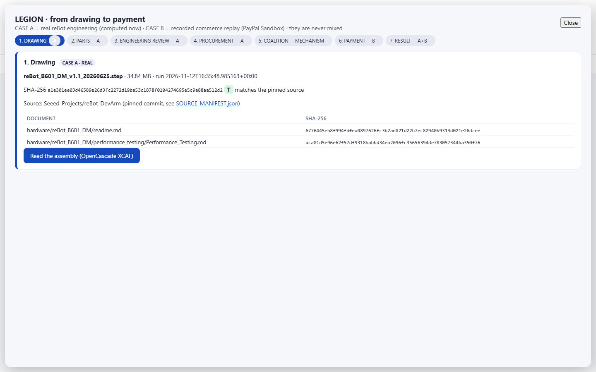
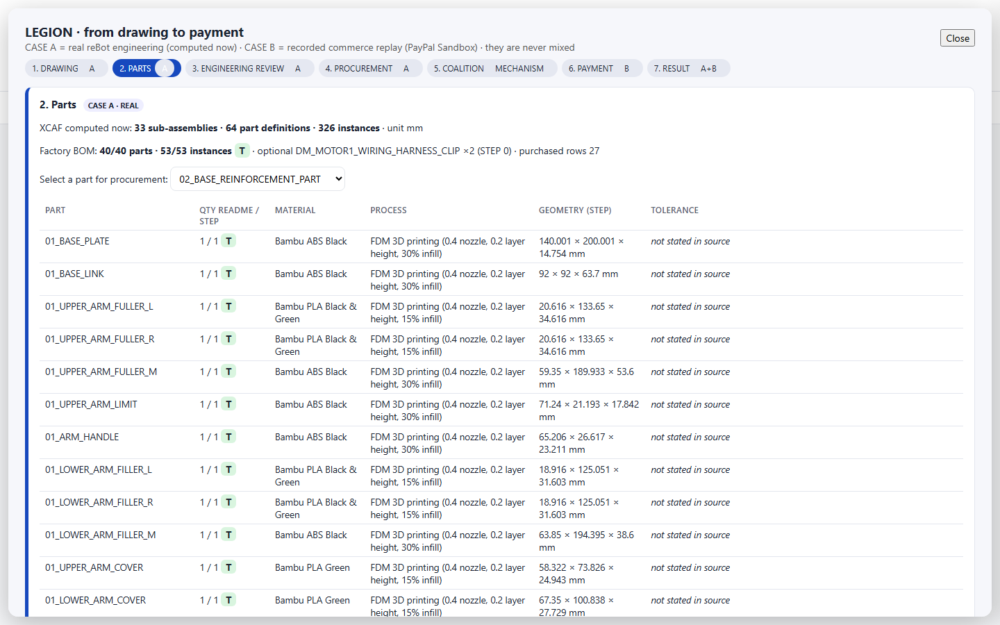
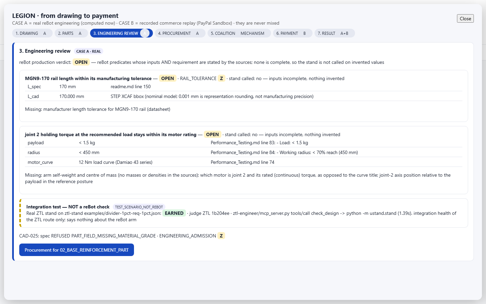
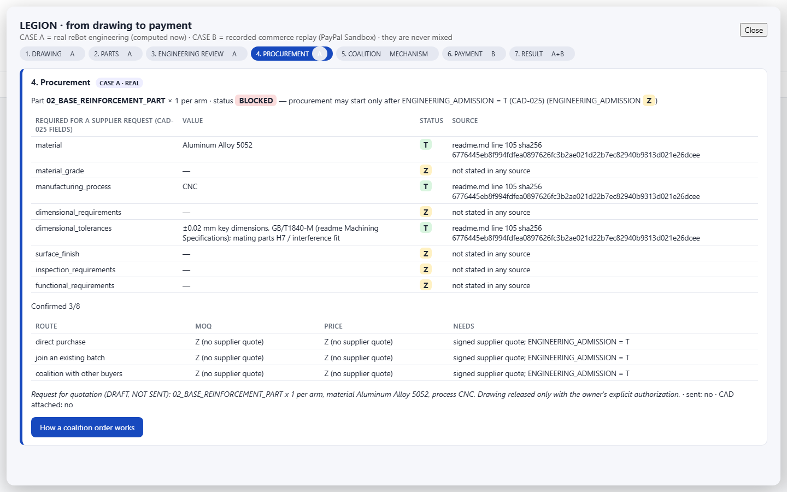
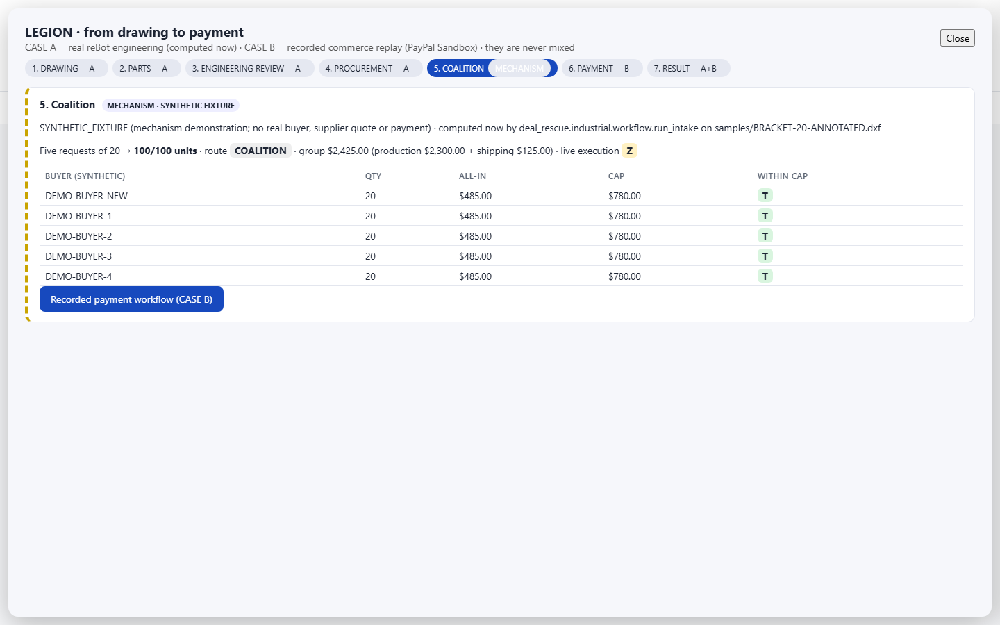
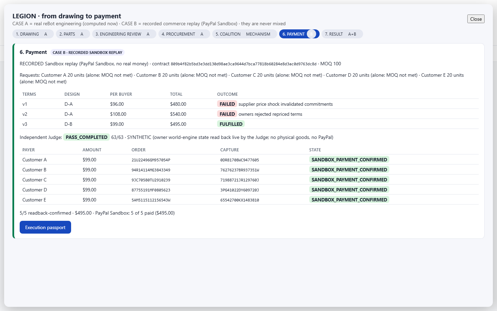
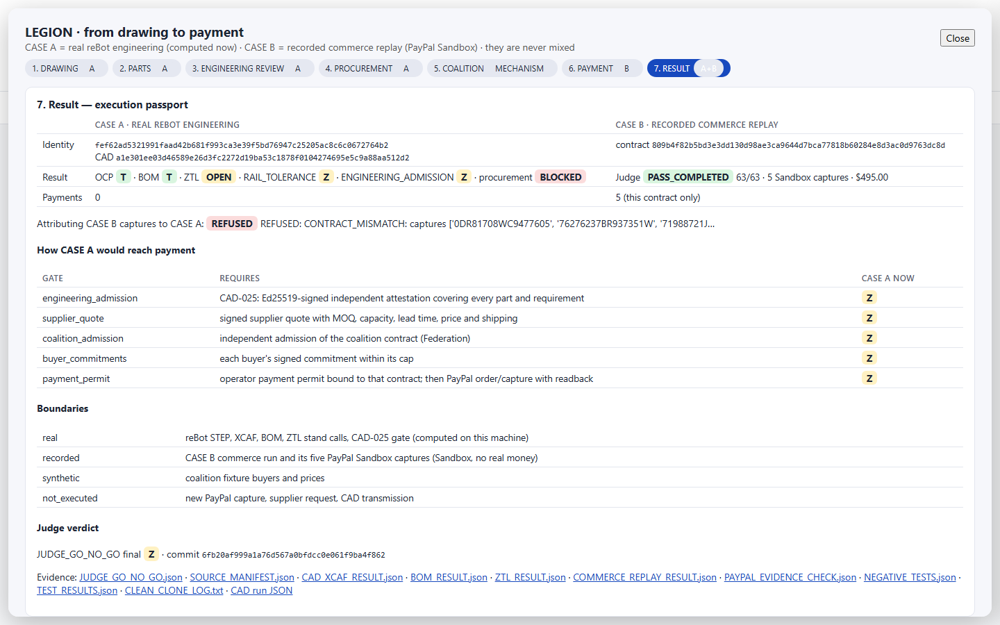

# LEGION Deal Rescue

**From a real CAD drawing to a verified collective deal and its PayPal payments — and every step is checked, not claimed.**

Apache-2.0 · Entry for the [PayPal AI Hackathon](https://paypalaihackathon.devpost.com/rules) ·
[](https://github.com/veraxis-protocol/LEGION-Deal-Rescue/actions/workflows/release-checks.yml)

## Judge Quickstart (one command)

Prerequisites: **Python 3.12+** and **Git**. Nothing else: no API keys, no PayPal account.

```bash
git clone https://github.com/veraxis-protocol/LEGION-Deal-Rescue.git
cd LEGION-Deal-Rescue
python -m scripts.judge_demo
```

The command:

1. creates an isolated `.judge_venv` with pinned packages, including OpenCascade;
2. downloads the real reBot B601-DM robot-arm STEP (34.8 MB), its factory BOM and its performance data from a pinned Seeed commit, and refuses any file whose SHA-256 differs;
3. checks out the ZTL Engineer, ZTL Stand and ZTL judge at pinned commits;
4. computes everything on your machine, writes `judge_out/JUDGE_GO_NO_GO.json`, runs a headless browser test, and opens the app.

It takes about 5 minutes on the first run and about 2 minutes after that. Linux, Windows and macOS on x86_64/arm64 are supported. Options: `--no-browser`, `--no-e2e`, `--ci`, `--port N`.

**What you will see:** click **Judge walkthrough · drawing to payment**. There are seven screens: DRAWING → PARTS → ENGINEERING REVIEW → PROCUREMENT → COALITION → PAYMENT → RESULT. They hold two clearly separated cases:

| | CASE A: real engineering (computed now) | CASE B: verified commerce replay (recorded) |
|---|---|---|
| Input | reBot B601-DM STEP from Seeed, SHA `a1e301ee…` | five requests for 20 sensor modules each, below the factory's MOQ of 100 |
| Result | OpenCascade XCAF finds **33 sub-assemblies, 64 part definitions and 326 instances**. The factory BOM matches **40/40 parts and 53/53 instances**. The ZTL review is **OPEN** (`RAIL_TOLERANCE=Z`), the CAD-025 gate gives **ENGINEERING_ADMISSION=Z**, and procurement is **BLOCKED** | $480 fails on a price shock and $540 is rejected by every buyer's cap. **$495 is signed by all seven parties**. An independent Judge passes **63/63 checks**, and there are **5/5 PayPal Sandbox captures** confirmed by readback |
| Proof | `judge_out/CAD_XCAF_RESULT.json`, `BOM_RESULT.json`, `ZTL_RESULT.json` | `demo_evidence/`, `judge_out/COMMERCE_REPLAY_RESULT.json`, `PAYPAL_EVIDENCE_CHECK.json` |

The two cases never share a payment. The RESULT screen shows the gates that would connect CASE A to CASE B: engineering admission, a supplier quote, coalition admission, buyer commitments and a payment permit. An attempt to attach CASE B's captures to CASE A is refused (`CONTRACT_MISMATCH`). The COALITION screen shows the 5 × 20 → 100 mechanism on clearly labelled **synthetic** fixtures.

### What is proven (T / F / Z)

| Claim | Verdict | Where it is checked |
|---|---|---|
| Real STEP fetched and verified, XCAF tree computed (33/64/326) | **T** | judge preflight, `tests/judge_real_cad027.py`, CI `judge-e2e` |
| BOM matches the factory readme (40/40, 53/53) | **T** | same |
| ZTL stand really runs (a separately labelled test scenario is EARNED) | **T** | `ZTL_RESULT.json` (`integration_test`) |
| reBot engineering requirements proven | **Z (OPEN)** | no source states the rail tolerance, the arm masses or the motor ratings |
| ENGINEERING_ADMISSION | **Z** | needs an independent Ed25519-signed attestation (CAD-025) |
| Commerce replay rebuilt from raw evidence, Judge 63/63 | **T** | `COMMERCE_REPLAY_RESULT.json` |
| 5 PayPal Sandbox captures ($495, Sandbox money) bound to their own contract | **T** | `PAYPAL_EVIDENCE_CHECK.json`, [PAYPAL_STATUS.md](PAYPAL_STATUS.md) |
| New live PayPal capture | **Z / not executed** | no new payment is authorized |
| Negative checks (substituted STEP, quantity change, unsigned receipt, cross-contract payment, stale evidence, …) | **10/10 PASS**, 0 financial effects | `judge_out/NEGATIVE_TESTS.json` |
| Browser E2E, 7 screens at 1280×720 and 1440×900, 0 console errors | **T** | `judge_out/BROWSER_E2E_RESULT.json` |
| Same command on a clean GitHub runner, 0 required skips | **T** | CI job `judge-e2e` (artifact `judge-e2e`) |

### Architecture

```mermaid
flowchart LR
  subgraph A["CASE A · real engineering (computed now)"]
    S[Seeed reBot STEP<br/>pinned commit + SHA-256] --> X[OpenCascade XCAF<br/>33 / 64 / 326]
    X --> B[BOM vs factory readme<br/>40/40 · 53/53]
    B --> Z[ZTL Engineer → ZTL Stand<br/>OPEN · RAIL_TOLERANCE Z]
    Z --> G[CAD-025 gate<br/>ENGINEERING_ADMISSION Z]
    G --> P[Procurement<br/>BLOCKED]
  end
  subgraph M["COALITION mechanism (synthetic fixture)"]
    C[5 × 20 → MOQ 100<br/>$2,425 · $485 each]
  end
  subgraph Bc["CASE B · verified commerce replay (recorded)"]
    R[5 buyers · MOQ 100] --> V[$480 fail · $540 reject · $495 sign] --> J[independent Judge 63/63] --> Y[5 PayPal Sandbox captures<br/>readback-confirmed]
  end
  P -. "needs: admission T, supplier quote, coalition admission, buyer commitments, payment permit" .-> C
  C -. same mechanism .-> R
```



### Screens

| | |
|---|---|
|  |  |
|  |  |
|  |  |
|  | |

More: [DEMO_GUIDE.md](DEMO_GUIDE.md) (what to click) · [REPRODUCE.md](REPRODUCE.md) (all modes) · [docs/CAD027_DEMO.md](docs/CAD027_DEMO.md) (CAD and ZTL details) · [VERIFICATION.md](VERIFICATION.md) · [CHALLENGES_AND_LIMITS.md](CHALLENGES_AND_LIMITS.md)

**Production vs Sandbox:** PayPal amounts are Sandbox test money, not revenue. Manufacture and shipping in CASE B are simulated. The coalition fixture is synthetic. No supplier is contacted and no CAD file is sent anywhere.

---

# Product details

## 1. The problem

Small merchants turn away custom orders every day. A request is often too small for a supplier's minimum order, or it
needs an independent check nobody can arrange. Several such requests could be served together, but pooling strangers'
orders needs trust: who agreed to what, whose budget limit applies, who verified the work, and that nobody is charged
without consent.

## 2. The product

LEGION Deal Rescue is a merchant workspace that turns individually impossible requests into one verifiable collective
deal. Seven independent parties (five buyers, a manufacturer, a qualification engineer) each run their own process with
their own key, private policy and AI agent.

1. **Lost orders.** Five requests for 20 sensor modules each, at most $100 per customer. The factory's minimum order is 100 units, so each request alone is refused.
2. **Opportunity.** A marketplace sees only what each party chose to publish and finds that the five requests together reach 100 units. A match is not permission.
3. **Deal & approval.** Every price change creates a new contract version that each party must sign.
   - $480 is invalidated by a price shock (an injected test event).
   - $540, which is $108 per buyer, is refused by all five buyers because it is above each buyer's own cap.
   - A cheaper design fails the engineer's qualification and is never offered.
   - **$495, which is $99 per buyer**, is signed by all seven.
4. **Work & verification.** Manufacture, certification, five shipments and five ledger entries are replayed from the recorded events. An independent, read-only Judge reads every party's state and returns its verdict.
5. **Payment & outcome.** Each buyer pays its own $99 through PayPal. Fulfilment state and payment state are shown separately, and every payment links to PayPal's own records.

The app also has a customer offer view and a downloadable **Deal Dossier** and **Execution Passport**. Every number on
screen links to the exact record it came from: file, record, JSON path and SHA-256.

## 3. Demonstrated result

| What | Result | Evidence |
|---|---|---|
| Seven-party deal, fresh runs (each a first attempt) | **4 of 4** passed the independent Judge, **63/63 checks** each, 4/4 tamper tests detected | `demo_evidence/runs/`, [VERIFICATION.md](VERIFICATION.md) |
| Price above caps ($540) | refused by 5 of 5 buyers on their own cap rule | contract versions in each run |
| Incompatible cheaper design | rejected by the engineer, never offered | qualification records |
| Adversarial negatives against live parties | **25/25**, 0 forbidden effects | `demo_evidence/negatives/` |
| **PayPal Sandbox payments** | **5 of 5 buyers paid, $495.00**: 5 orders, 5 captures, each confirmed by an independent readback; 10 POSTs, 0 retries, 0 duplicate captures | [PAYPAL_STATUS.md](PAYPAL_STATUS.md), `demo_evidence/paypal_runs/` |

**What is not claimed:**
- PayPal amounts are **Sandbox test money**, not revenue.
- Manufacture, shipping and buyer-ledger entries are **simulated**.
- The deal is **not profitable**: buyers pay $495 and the costs are $495.
- Production payment acceptance (an independent review of the payment adapter) is **not signed**.

See [CHALLENGES_AND_LIMITS.md](CHALLENGES_AND_LIMITS.md).

## 4. PayPal integration

Each buyer's $99 is a separate PayPal **Orders v2** payment. Every link in the chain below is read from retained evidence:

`contract → buyer's own signed consent → operator-signed payment authorization + one-time permit → admission decision → order → buyer approval on PayPal → server check of APPROVED → capture → independent readback`

The payment adapter keeps:
- durable reservations;
- idempotent request IDs;
- no blind retry after an uncertain response.

It captures only after PayPal itself reports the buyer's approval. A second process re-reads PayPal's records before the app shows a payment as confirmed.

Details: [PAYPAL_STATUS.md](PAYPAL_STATUS.md). The exact code that made the five captures: [docs/PAYMENT_RUNTIME.md](docs/PAYMENT_RUNTIME.md).

## 5. Architecture

| Layer | Component | Where |
|---|---|---|
| Parties | 7 party processes (key, private policy, simulated world, NVIDIA NIM agent) | LEGION-Federation (external) |
| Discovery & harness | intent publication, matching, end-to-end run, independent Judge | LEGION-Marketplace (external) |
| Runtime | LEGION Core worlds and admission | LEGION (external) |
| Payments | PayPal Orders v2 gateway | `paypal_adapter/` (this repo) |
| Payment orchestration | per-payer authorization, admission, readback | LEGION-Commerce (external, by commit and hash) |
| Merchant app | dossier builder, read-only server, UI, evidence auditor, economics | `deal_rescue/` (this repo) |

Full dependency map with revisions and licenses: [docs/DEPENDENCY_MAP.md](docs/DEPENDENCY_MAP.md).

### Industrial Sourcing (preview)

The header button **Industrial Sourcing** opens a read-only panel that applies the same approach to manufactured parts:

- buyer requests are grouped only when the specification digest, revision, process and material match exactly;
- four routes are compared: direct purchase, single additive build, split supply and collective procurement;
- the result is a Federation **proposal** (not an admitted contract), an evidence passport and an **unsent** draft RFQ.

It ships three synthetic scenarios (coalition chosen at $2,300 vs $3,850 direct; direct chosen when it costs $2,000; a revision mismatch that leaves 80 of the required 100 units and is held). Supplier entries are 87 public discovery links, not quotations. Engineering verification stays unproven until an independent ZTL Engineering receipt is supplied. No supplier is contacted and no payment is made. Details: [docs/INDUSTRIAL_SOURCING.md](docs/INDUSTRIAL_SOURCING.md).

## 6. Installation and use

**Judge Mode (recommended).** `python -m scripts.judge_demo`: see the [Judge Quickstart](#judge-quickstart-one-command). It covers CASE A (the real CAD) and CASE B (the commerce replay) in one app.

**A. Explore the recorded runs only.** Any OS, Python 3.12+, no credentials.

```bash
git clone https://github.com/veraxis-protocol/LEGION-Deal-Rescue.git
cd LEGION-Deal-Rescue
python -B scripts/build_and_serve.py --evidence demo_evidence
# open http://127.0.0.1:8795/?run=run-2
```

This rebuilds every dossier from the raw records, re-audits them and serves the app. `run-2` carries the five PayPal
payments. `run-1` is a separate run with a different contract and correctly shows no payments.

**B. Run a fresh seven-party deal with live AI decisions.** Windows PowerShell plus your own NVIDIA NIM key in a local file.

```powershell
.\scripts\run_live_e2e.ps1 -NimKeyFile C:\path\to\nvapi.txt
```

The script:
1. clones the external LEGION components at pinned commits;
2. runs the seven-party episode;
3. runs the independent Judge and the 25 adversarial negatives;
4. builds, audits and serves the result.

**C. PayPal payments.** These are not part of A or B. Each payment needs the platform operator's signed authorization for specific
buyers, and each buyer's approval on PayPal's own page. See [REPRODUCE.md](REPRODUCE.md#c-paypal-sandbox-payments).

## 7. Verification

```bash
python -m scripts.judge_demo --ci                                            # everything a judge runs, plus all tests (Linux: incl. pmix)
python -B -m unittest discover -s tests -v                                   # release tests, offline (0 skips)
pip install -r paypal_adapter/requirements.lock
cd paypal_adapter && python -B -m unittest discover -s tests -t . && cd ..   # 46 payment adapter tests (Windows)
python -B scripts/run_payment_negatives.py                                   # payment negative controls
```

GitHub Actions runs these checks on every push (`.github/workflows/release-checks.yml`). The `judge-e2e` job runs `python -m scripts.judge_demo --ci` on a clean Ubuntu runner, with the real STEP, the real ZTL and the browser E2E, and requires 0 required skips. Recorded results: [VERIFICATION.md](VERIFICATION.md).

## 8. Licensing

- **This repository is Apache-2.0** ([LICENSE](LICENSE), [NOTICE](NOTICE)).
- The live seven-party run (B) uses LEGION Core, LEGION-Federation and LEGION-Marketplace.
  - They remain under **PolyForm Noncommercial 1.0.0**.
  - They are fetched at pinned commits and are not copied here.
  - Commercial use of those components requires a separate agreement with Veraxis.
- Mode A, the tests and the payment adapter run without them.
- The organizers have not ruled on this dependency structure.

See [PROVENANCE_AND_LICENSE.md](PROVENANCE_AND_LICENSE.md).
